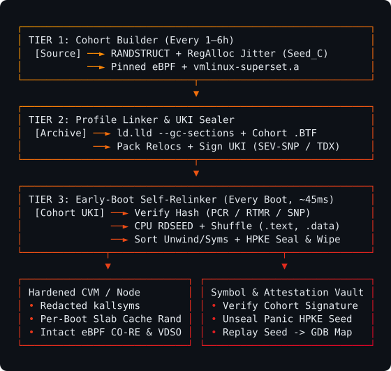

<p align="center">
  
</p>

durable, fail-open kernel diversification library for per-boot layout randomization.

___

in the frontier red-team era—where autonomous agents and anyone on the internet can synthesize working kernel exploits on demand—fleet monoculture is a liability. when every host running the same kernel release shares the exact same binary layout, a single pointer leak gives an exploit deterministic offsets to every ROP/JOP gadget, privileged global (`modprobe_path`, `core_pattern`), struct member, and slab cache across the entire fleet. **swizzle** introduces client diversity at the kernel layer through cacheline-bucketed struct randomization (`RANDSTRUCT`), in-enclave per-boot ELF section permutation (`.text.*`, `.data.*`, `.rodata.*`), and caller-IP slab cache isolation—so one-shot exploits fail across machines and across reboots.

diversifying kernel binaries normally mutates their measurement hash and breaks hardware root-of-trust attestation across UEFI Secure Boot, TPM 2.0 (`systemd-pcrlock`), AMD SEV-SNP (`ID_BLOCK`), and Intel TDX (`RTMR`). swizzle preserves cryptographic attestation by decoupling build-time cohort signing from runtime layout permutation: hardware verifies and measures a deterministic, signed cohort UKI first, and the early-boot decompression stub then draws fresh hardware entropy (`RDSEED`) inside the confidential guest boundary to relink sections and re-sort exception, ORC unwind, and symbol tables in RAM before `start_kernel()`. if a kernel panics, it emits a compact RFC 9180 HPKE ciphertext containing the boot seed so the Symbol Vault can deterministically reconstruct the exact per-boot DWARF/GDB layout with zero per-boot binary storage.

<p align="center">
  
</p>

### layout

- [`kernel/arch/x86/include/asm/swizzle_boot.h`](kernel/arch/x86/include/asm/swizzle_boot.h): kernel descriptor (`SWZLDESC`) and packed relocation (`SWZL`) structs.
- [`kernel/arch/x86/boot/compressed/swizzle.c`](kernel/arch/x86/boot/compressed/swizzle.c): early-boot section shuffler, `R_X86_64_*` relocator, and in-place table heapsort.
- [`kernel/kernel/swizzle_panic.c`](kernel/kernel/swizzle_panic.c): early-boot rfc 9180 hpke seed sealer and lockless panic notifier.
- [`kernel/lib/swizzle_kallsyms.c`](kernel/lib/swizzle_kallsyms.c) & [`kernel/mm/swizzle_slab.c`](kernel/mm/swizzle_slab.c): address-redacted stack traces (`%pS`) and slab freelist jitter.
- [`kernel/patches/0001-x86-boot-swizzle-integration.patch`](kernel/patches/0001-x86-boot-swizzle-integration.patch): kernel wiring for `misc.c`, `boot.h`, `vmlinux.lds.S`, and `vsprintf.c`.
- [`src/`](src/lib.rs): rust diversification library (`swizzle`) and symbol vault cli (`swizzle-ctl`).

### usage

```bash
# generate symbol vault keypair
cargo run -- keygen --pub-out vault_pubkey.bin --priv-out vault_privkey.hex

# pack cohort relocations
cargo run -- pack-relocs --out packed_relocs.bin

# decrypt a panic envelope and replay the boot layout
cargo run -- debug \
  --cohort 8f9c2d11a04e77b29104c88d3a1f5e6099b1c2d3e4f5a6b7c8d9e0f1a2b3c4d5 \
  --envelope "hpke:v1:<32B_enc_hex>:<48B_ct_tag_hex>" \
  --priv-key vault_privkey.hex \
  --relocs-bin packed_relocs.bin \
  --rip 0xffffffff81000484 \
  --gdb-out swizzle-layout.gdb

# run c-to-rust end-to-end verification
cargo run -- self-test
```
